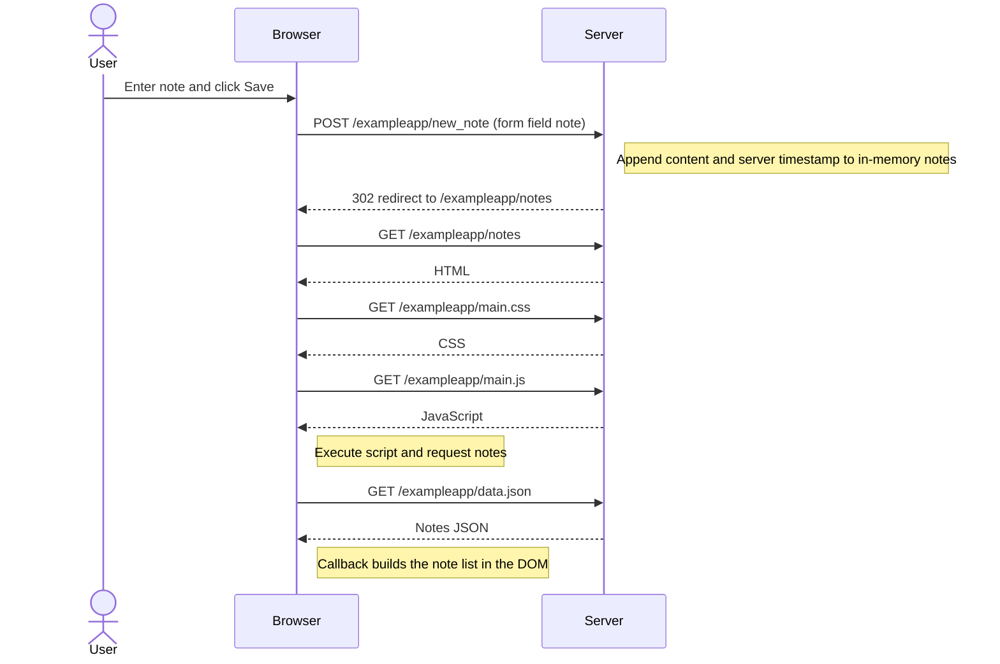
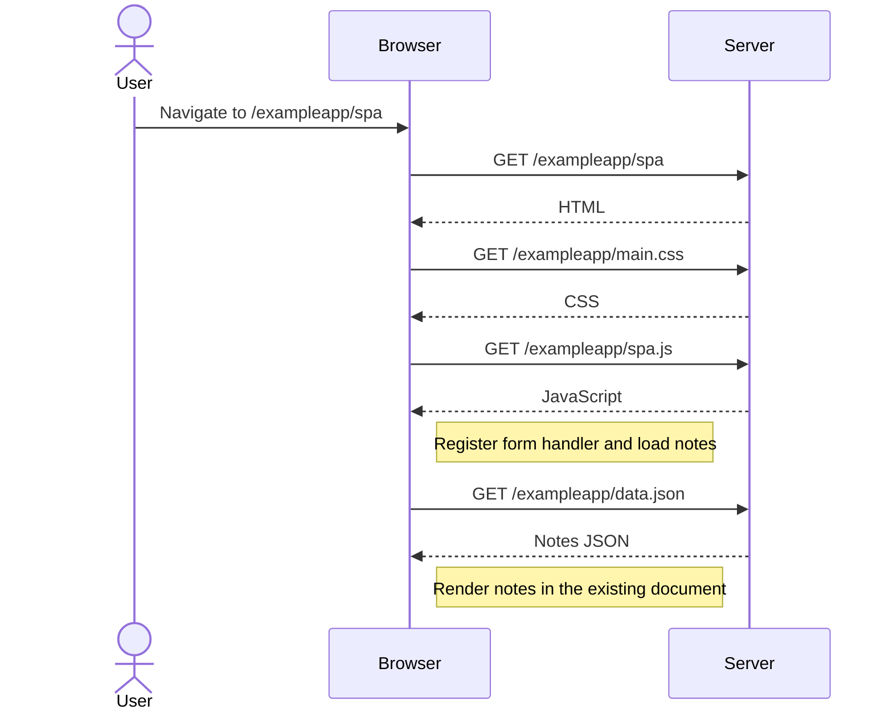
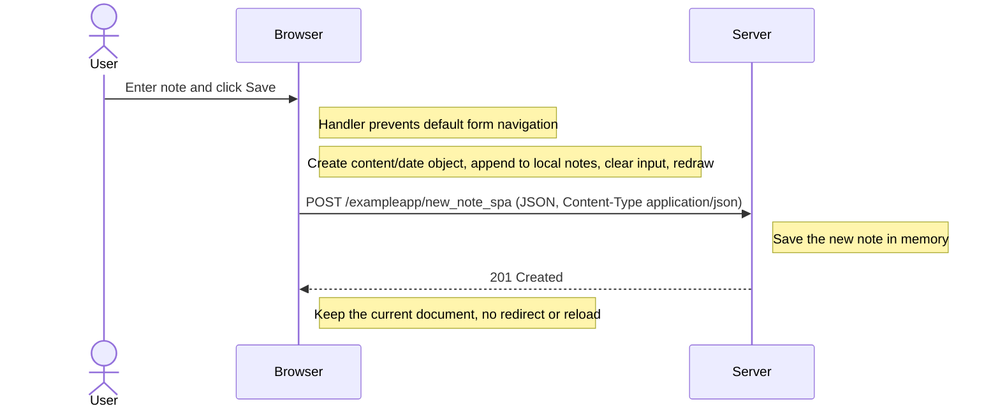

# Full Stack Open — Part 0

Prepared by Codex (AI) at the account holder's request. This assistance is disclosed in the course submission. These diagrams are not represented as independently authored by the account holder.

Read the official Fundamentals of Web Apps chapter and the linked MDN HTML, CSS, and first-form tutorials (exercises 0.1–0.3). The following original diagrams cover exercises 0.4–0.6. No claim that the user personally completed these readings or authored these diagrams.

Source: https://fullstackopen.com/en/part0/fundamentals_of_web_apps/

## 0.4 — New note with traditional form submission

CSS and JavaScript requests may overlap; the diagram describes dependencies, rather than asserting that every browser serializes them.

## 0.5 — Opening the SPA

## 0.6 — New note in the SPA

The demo stores notes in memory, not a durable database. A local DOM change alone does not save server data. The SPA updates the list before the POST completes, which can leave a local/server mismatch if that request fails.
